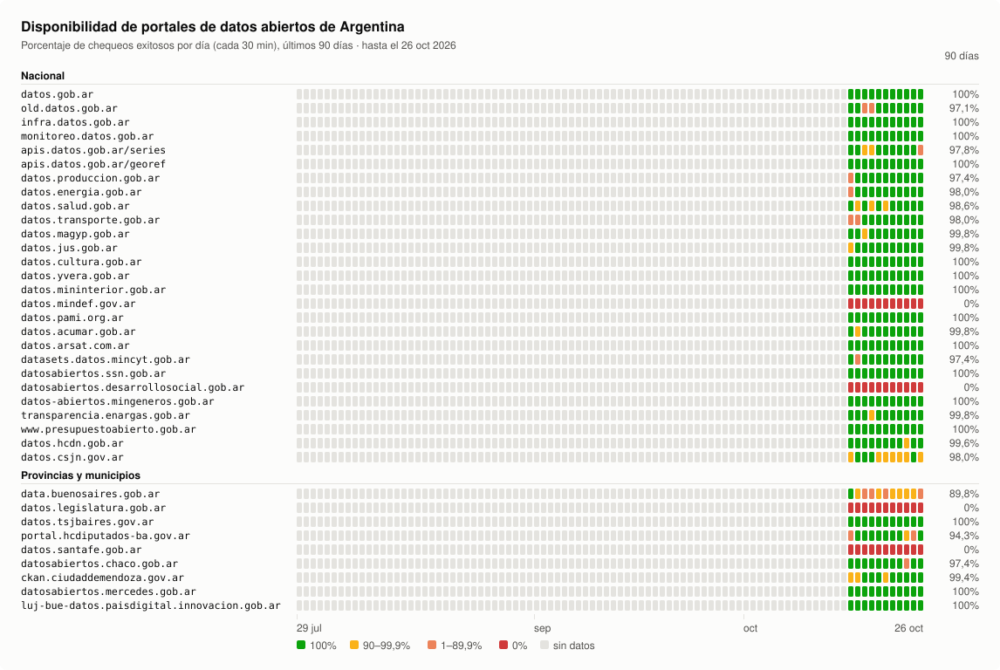

# monitoreo-publico

Monitoreo de disponibilidad de los portales de datos abiertos de Argentina: el portal nacional
[datos.gob.ar](https://datos.gob.ar), los portales de ministerios y organismos que cosecha,
y portales de provincias, municipios, legislaturas y tribunales.

Cada 30 minutos se consulta cada portal y se guarda el resultado. Una vez por día se regenera
este gráfico con los últimos 90 días.



## Estado

<!-- uptime:start -->
_Actualizado el 2026-10-23._

| Portal | Último chequeo | 7 días | 90 días |
|---|---|--:|--:|
| [datos.gob.ar](https://datos.gob.ar/) | 🟢 disponible | 100% | 100% |
| [old.datos.gob.ar](https://old.datos.gob.ar/) | 🟢 disponible | 95,5% | 95,9% |
| [infra.datos.gob.ar](https://infra.datos.gob.ar/catalog/sspm/data.json) | 🟢 disponible | 100% | 100% |
| [monitoreo.datos.gob.ar](https://monitoreo.datos.gob.ar/catalog/jgm/data.json) | 🟢 disponible | 100% | 100% |
| [apis.datos.gob.ar/series](https://apis.datos.gob.ar/series/api/series/?ids=143.3_NO_PR_2004_A_21&limit=1) | 🟢 disponible | 99,1% | 99,2% |
| [apis.datos.gob.ar/georef](https://apis.datos.gob.ar/georef/api/provincias?max=1) | 🟢 disponible | 100% | 100% |
| [datos.produccion.gob.ar](https://datos.produccion.gob.ar/) | 🟢 disponible | 100% | 96,4% |
| [datos.energia.gob.ar](http://datos.energia.gob.ar/) | 🟢 disponible | 100% | 97,3% |
| [datos.salud.gob.ar](https://datos.salud.gob.ar/) | 🟢 disponible | 97,9% | 98,1% |
| [datos.transporte.gob.ar](https://datos.transporte.gob.ar/) | 🟢 disponible | 98,5% | 97,3% |
| [datos.magyp.gob.ar](https://datos.magyp.gob.ar/) | 🟢 disponible | 99,7% | 99,7% |
| [datos.jus.gob.ar](https://datos.jus.gob.ar/) | 🟢 disponible | 100% | 99,7% |
| [datos.cultura.gob.ar](https://datos.cultura.gob.ar/) | 🟢 disponible | 100% | 100% |
| [datos.yvera.gob.ar](https://datos.yvera.gob.ar/) | 🟢 disponible | 100% | 100% |
| [datos.mininterior.gob.ar](https://datos.mininterior.gob.ar/) | 🟢 disponible | 100% | 100% |
| [datos.mindef.gov.ar](https://datos.mindef.gov.ar/) | 🔴 connection reset | 0% | 0% |
| [datos.pami.org.ar](https://datos.pami.org.ar/) | 🟢 disponible | 100% | 100% |
| [datos.acumar.gob.ar](https://datos.acumar.gob.ar/) | 🟢 disponible | 99,7% | 99,7% |
| [datos.arsat.com.ar](https://datos.arsat.com.ar/) | 🟢 disponible | 100% | 100% |
| [datasets.datos.mincyt.gob.ar](https://datasets.datos.mincyt.gob.ar/) | 🟢 disponible | 96,1% | 96,4% |
| [datosabiertos.ssn.gob.ar](https://datosabiertos.ssn.gob.ar/) | 🟢 disponible | 100% | 100% |
| [datosabiertos.desarrollosocial.gob.ar](https://datosabiertos.desarrollosocial.gob.ar/) | 🔴 dns | 0% | 0% |
| [datos-abiertos.mingeneros.gob.ar](https://datos-abiertos.mingeneros.gob.ar/) | 🟢 disponible | 100% | 100% |
| [transparencia.enargas.gob.ar](https://transparencia.enargas.gob.ar/) | 🟢 disponible | 99,7% | 99,7% |
| [www.presupuestoabierto.gob.ar](https://www.presupuestoabierto.gob.ar/) | 🟢 disponible | 100% | 100% |
| [datos.hcdn.gob.ar](https://datos.hcdn.gob.ar/) | 🟢 disponible | 100% | 100% |
| [datos.csjn.gov.ar](https://datos.csjn.gov.ar/) | 🟢 disponible | 97,9% | 97,8% |
| [data.buenosaires.gob.ar](https://data.buenosaires.gob.ar/) | 🟢 disponible | 87,8% | 88,8% |
| [datos.legislatura.gob.ar](https://datos.legislatura.gob.ar/) | 🔴 connection refused | 0% | 0% |
| [datos.tsjbaires.gov.ar](https://datos.tsjbaires.gov.ar/) | 🟢 disponible | 100% | 100% |
| [portal.hcdiputados-ba.gov.ar](https://portal.hcdiputados-ba.gov.ar/) | 🟢 disponible | 100% | 98,6% |
| [datos.santafe.gob.ar](https://datos.santafe.gob.ar/) | 🔴 invalid http response | 0% | 0% |
| [datosabiertos.chaco.gob.ar](https://datosabiertos.chaco.gob.ar/) | 🟢 disponible | 100% | 100% |
| [ckan.ciudaddemendoza.gov.ar](https://ckan.ciudaddemendoza.gov.ar/) | 🟢 disponible | 99,4% | 99,2% |
| [datosabiertos.mercedes.gob.ar](https://datosabiertos.mercedes.gob.ar/) | 🟢 disponible | 100% | 100% |
| [luj-bue-datos.paisdigital.innovacion.gob.ar](http://luj-bue-datos.paisdigital.innovacion.gob.ar/) | 🟢 disponible | 100% | 100% |
<!-- uptime:end -->

## Cómo se mide

- La lista de portales está en [`portals.json`](portals.json). Se armó a partir de las fuentes de
  cosecha de datos.gob.ar y de otros portales públicos conocidos.
- Cada chequeo hace un `GET` a la URL del portal (con un user-agent de navegador, porque
  datos.gob.ar bloquea a los bots) y lee los primeros 64 KB de la respuesta.
- Un portal está **disponible** si responde con un código HTTP menor a 400 en menos de 30
  segundos. Si falla, se reintenta una vez a los 5 segundos.
- Muchos sitios `gob.ar` sirven certificados con la cadena incompleta, que los navegadores
  completan solos. En esos casos el chequeo se repite sin verificar el certificado y el error
  queda registrado en `tls_error`, pero no cuenta como caída.
- El porcentaje diario es la proporción de chequeos exitosos del día (hora de Argentina).

## Datos

Hay un archivo por portal y por día, en hora de Argentina:

```
data/datos.produccion.gob.ar/2026-10-16.json
```

```json
{
  "id": "datos.produccion.gob.ar",
  "url": "https://datos.produccion.gob.ar/",
  "date": "2026-10-16",
  "timezone": "America/Argentina/Buenos_Aires",
  "checks": [
    {"time": "2026-10-16T10:00:01-03:00", "up": false, "status": null, "ms": 30012, "error": "timeout"},
    {"time": "2026-10-16T10:30:01-03:00", "up": true, "status": 200, "ms": 412}
  ]
}
```

`status` es el código HTTP (o `null` si no hubo respuesta), `ms` el tiempo hasta recibir la
respuesta, y `error` el motivo de la caída (`timeout`, `dns`, `connection refused`, `http 503`…).

## Correrlo

Sin dependencias, solo Python 3.9+:

```sh
python3 monitor/check.py    # un chequeo de todos los portales
python3 monitor/render.py   # regenera assets/uptime.svg y la tabla de este README
```

`monitor/cron.sh` corre el chequeo y sube los datos; se ejecuta con cron cada 30 minutos.
El gráfico lo regenera [una GitHub Action](.github/workflows/render.yml) todos los días a las
00:30 (hora de Argentina).
